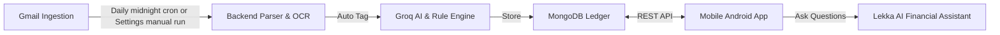

# Lekka

Personal expense tracking without the spreadsheet drama. Lekka reads selected finance emails, pulls useful spend data, lets you add cash/friend-paid expenses manually, and gives you one clean Android ledger with AI help when you want answers fast.



---

## What Lekka Does

* **Email to ledger**: Pulls only selected bank, payment, investment, and policy emails from Gmail.
* **No amount, no fake expense**: If a selected email has no clear amount, Lekka makes a review notification instead of inventing spend.
* **Manual expenses**: Add cash, UPI, card, and friend-paid entries from the app.
* **Edit and delete**: Fix transactions later when the amount, date, category, or notes need cleanup.
* **Stats that actually help**: See today, week, month, quarter, yearly totals, charts, categories, modes, and trends.
* **AI assistant**: Ask questions against your real ledger context. The AI can read, not mutate.
* **Rules**: Category rules run before AI so repeat merchants stay predictable.
* **Your categories, your call**: Every new pattern goes to Review with an AI suggestion. Only your saved choice trains a sender-plus-merchant rule for next time. Create a category directly in Review or rename it in Settings without breaking its history.
* **Separate money flows**: Debits and incoming credits are tracked separately. Credits never inflate spending, and unclear transactions go to review. [Ledger flow details](docs/ledger-flows.md).
* **Android-native bits**: compact PIN lock, fingerprint unlock, local confirmations, and FCM remote notifications once Firebase is configured.
* **AI chats**: separate saved conversations, chat history, and a composer that fits above the keyboard.
* **Cache first**: saved production data opens instantly from IndexedDB after unlocking. Fresh same-day reopens skip backend reads; writes still go to production immediately and refresh one complete snapshot. [Sync details](docs/cache-sync.md).

Remote push setup and the daily notification plan: [the Firebase guide](docs/push-notifications.md).
* **LLM export**: Save a local JSON context bundle for deeper review elsewhere.

---

## Tech Stack

| Layer | Tools | What it handles |
| :--- | :--- | :--- |
| Mobile App | React, Vite, Capacitor 6, TypeScript | Android APK and web client |
| Mobile Security | Hardware Biometrics, LocalNotifications, FCM | Fingerprint prompt, local confirmations, remote alerts |
| Backend Server | Node.js, Express, TypeScript | REST APIs, ingestion pipeline, cron jobs |
| Database | MongoDB | Stores emails, categories, rules, and notifications |
| AI Intelligence | Groq API (`qwen/qwen3.8-27b`) | Merchant classification and chat assistant tool calling |
| OCR Engine | Tesseract.js | Extracts text and totals from image receipts |

---

## Project Structure

```
Lekka/
├── app/                  # Mobile frontend (React + Vite + Capacitor 6)
│   ├── android/          # Native Android project files
│   ├── public/           # Service worker and web manifest
│   ├── src/              # App components, screens, design system
│   └── capacitor.config.json
├── backend/              # Node.js backend
│   ├── src/controllers/  # API routes for emails, rules, chat, analytics
│   ├── src/models/       # Mongoose data schemas
│   ├── src/services/     # Groq AI, Gmail IMAP, OCR, Rule engine
│   └── src/server.ts     # Express server entry point
├── docker-compose.yml    # MongoDB container configuration
└── README.md
```

---

## Quick Start

### 1. Start Local MongoDB
If you have Docker installed, spin up MongoDB with one command:
```bash
docker compose up -d mongodb
```
MongoDB will start listening on port 27017.

### 2. Configure Backend Environment
Edit `backend/.env` with your credentials:
```env
PORT=5000
MONGODB_URI=mongodb://localhost:27017/lekka_db
GROQ_API_KEY=your_groq_api_key_here
GROQ_API_KEY_1=optional_backup_groq_key
GROQ_API_KEY_2=optional_backup_groq_key

# API security secret used by the app and smoke tests
LEKKA_API_SECRET=your_secure_api_secret_here
CRON_SECRET=your_secure_api_secret_here

# Gmail App Password for receipt fetching
GMAIL_USER=your_email@gmail.com
GMAIL_APP_PASSWORD=your_app_password_here
TARGET_SENDER_EMAILS=target_merchants@example.com

# Cron schedule for backend ingestion.
# Vercel evaluates cron in UTC, so this is 12:00 AM IST.
INGESTION_CRON_SCHEDULE=30 18 * * *
```

Current production sender allowlist:
```text
axismf@kfintech.com
noreply@groww.in
noreply@phonepe.com
alerts@axis.bank.in
no-reply@razorpay.com
nse-direct@nse.co.in
policynoreply@service.uiic.co.in
samf@kfintech.com
enq_k@camsonline.com
```

### 3. Run Backend Server
```bash
cd backend
npm install
npm run dev
```
The backend API will run on `http://localhost:5000`.

### 4. Run Mobile App
```bash
cd app
npm install
npm run dev
```
The app will run locally on `http://localhost:5173`.

---

## Production Flow

### Backend

The production backend is deployed on Vercel:
```text
https://lekka-suryas-projects-f3f7a1b9.vercel.app
```

Required Vercel env vars:
```env
MONGODB_URI=...
GROQ_API_KEY_1=...
GROQ_API_KEY_2=...
LEKKA_API_SECRET=...
CRON_SECRET=...
GMAIL_USER=...
GMAIL_APP_PASSWORD=...
TARGET_SENDER_EMAILS=...
INGESTION_CRON_SCHEDULE=30 18 * * *
GMAIL_IMAP_SCAN_LIMIT=300
GMAIL_INGEST_LIMIT=50
PORT=5000
```

Do not commit real secrets. Keep them in `backend/.env` locally and Vercel environment variables in production.

### Ingestion

Lekka matches complete sender addresses from `TARGET_SENDER_EMAILS`. IMAP searches matching messages across the Inbox, fetches lightweight headers first, and downloads only candidate bodies. UID checkpoints prevent an old forwarded date or a processing limit from silently skipping mail. Initial recovery is bounded by `GMAIL_IMAP_SCAN_LIMIT`; body downloads per run are bounded by `GMAIL_INGEST_LIMIT`.

Trusted personal forwarders can be listed in `TRUSTED_FORWARDER_EMAILS`; the forwarded bank sender must still be selected. A private `INGESTION_TEST_RECIPIENT` plus-address and the `[LEKKA TEST]` subject prefix allow real test emails from another personal account without accepting ordinary personal mail.

Use `cd backend` then `npm run mail:preview` for a read-only production filter check. For the two test messages and Google's forwarding setup, see [mail ingestion testing](docs/mail-ingestion.md). The backend never creates test expenses without receiving actual test emails.

Emails that do not contain an amount are stored as notifications/review signals instead of expenses.

Automatic ingestion runs from the backend cron schedule. Vercel cron is UTC-only, so midnight IST is configured as `30 18 * * *`. Vercel calls cron paths with `GET` and sends `Authorization: Bearer CRON_SECRET`, so `/api/ingest` supports both cron `GET` and manual app `POST`. Manual ingestion lives under Settings as `Manual Gmail ingestion`; it is intentionally not on Home because it can pull inbox data.

The notification schedule stays useful: a 9 AM IST check only sends when review or uncategorized work remains, Sunday 9 PM reports show recorded weekly spend, and the last-day-of-month 9 PM report shows recorded monthly spend with its actual cutoff. New ingestion, missing amounts, and automatic sync failures generate contextual alerts. Review emails can be marked reviewed in the app so they stop counting as pending.

`GET /api/system/sync-status` exposes recent job start/finish times, results, and whether Vercel cron or a manual request invoked them. Vercel Hobby timing has hour-level precision, so a midnight schedule does not promise execution at exactly 00:00.

### Mobile App

The Android app uses the production backend from `app/eas.json`:
```env
VITE_BACKEND_URL=https://lekka-suryas-projects-f3f7a1b9.vercel.app
VITE_LEKKA_API_SECRET=...
```

Capacitor Android uses the WebView origin `https://localhost`, so backend CORS must allow:
```text
https://localhost
capacitor://localhost
```

### Verification

Before building an APK, run:
```bash
cd backend
npm run build

cd ../app
npm run test:prod-config
npm run test:native-features
npm run build
```

`test:prod-config` checks production backend compatibility, API auth, AI chat, and Android WebView CORS.

---

## Building Android APK with EAS

To generate a standalone Android APK:

1. Sync web bundle to Android:
```bash
cd app
npm run build
npx cap sync android
```

2. Trigger cloud APK build:
```bash
npx eas-cli build -p android --profile preview
```
Download the generated `.apk` file directly to your phone.
