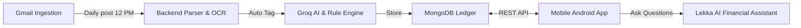

# Lekka: Smart Automated Ledger and Expense Tracker

Most people track expenses by typing each payment into an app by hand. Lekka automates the whole thing by connecting directly to your transactional emails, reading invoice receipts, categorizing spend with local rules and Groq AI, and keeping a clean financial ledger right on your phone.



---

## What Lekka Does

* **Automated Email Ingestion**: Reads receipts and invoice emails from your inbox every day after 12:00 PM. No manual copy-pasting.
* **Smart Parsing & OCR**: Extracts merchant names, billed amounts, dates, and payment modes from raw HTML and receipt attachments using Tesseract OCR.
* **Hybrid Category Classifier**: Matches receipts against custom keyword rules first. If no rule matches, it asks Groq AI to classify the merchant with low latency.
* **Cash & Manual Expense Tracking**: Log physical cash payments, friend splits, and UPI spends in two taps so your offline cash flow stays in sync with your digital receipts.
* **Built-in Groq AI Assistant**: Chat with an in-app AI that has read-only access to your real database. Ask questions like "How much did I spend on food this month?" or "Find all Swiggy orders" and get immediate answers with live numbers.
* **Rule Builder & Feedback Loop**: Create custom classification rules on the fly or type new custom categories. If you change a category on any receipt, Lekka can auto-train a new rule so future emails get categorized automatically.
* **Hardware Biometrics & Security**: Lock your ledger with a 4-digit PIN code and native Android fingerprint sensors.
* **Android Push Notifications**: Get push alerts for sync completions, pending approvals, and daily financial summaries.
* **LLM Context Exporter**: Export your entire ledger, receipts, and rules into a clean structured JSON file ready to feed into any large language model.

---

## Tech Stack

| Layer | Tools | What it handles |
| :--- | :--- | :--- |
| Mobile App | React, Vite, Capacitor 6, TypeScript | Android APK and web client |
| Mobile Security | Hardware Biometrics, LocalNotifications | Fingerprint sensor prompt and native push alerts |
| Backend Server | Node.js, Express, TypeScript | REST APIs, ingestion pipeline, cron jobs |
| Database | MongoDB | Stores emails, categories, rules, and notifications |
| AI Intelligence | Groq API (`qwen/qwen3.8-27b`) | Merchant classification and chat assistant tool calling |
| OCR Engine | Tesseract.js | Extracts text and totals from image receipts |

---

## Project Structure

```
Lekka/
├── app/                  # Mobile frontend (React + Vite + Capacitor 6)
│   ├── android/          # Native Android project files
│   ├── public/           # Service worker and web manifest
│   ├── src/              # App components, screens, design system
│   └── capacitor.config.json
├── backend/              # Node.js backend
│   ├── src/controllers/  # API routes for emails, rules, chat, analytics
│   ├── src/models/       # Mongoose data schemas
│   ├── src/services/     # Groq AI, Gmail IMAP, OCR, Rule engine
│   └── src/server.ts     # Express server entry point
├── api/                  # Vercel serverless function entry
├── docker-compose.yml    # MongoDB container configuration
├── vercel.json           # Vercel deployment routes and crons
└── README.md
```

---

## Quick Start

### 1. Start Local MongoDB
If you have Docker installed, spin up MongoDB with one command:
```bash
docker compose up -d mongodb
```
MongoDB will start listening on port 27017.

### 2. Configure Backend Environment
Edit `backend/.env` with your credentials:
```env
PORT=5000
MONGODB_URI=mongodb://localhost:27017/lekka_db
GROQ_API_KEY=your_groq_api_key_here

# Gmail App Password for Receipt Fetching
GMAIL_USER=your_email@gmail.com
GMAIL_APP_PASSWORD=your_app_password_here
TARGET_SENDER_EMAILS=target_merchants@example.com

LEKKA_API_SECRET=your_secure_api_secret_here
```

### 3. Run Backend Server
```bash
cd backend
npm install
npm run dev
```
The backend API will run on `http://localhost:5000`.

### 4. Run Mobile App
```bash
cd app
npm install
npm run dev
```
The app will run locally on `http://localhost:5173`.

---

## Building Android APK with EAS

To generate a standalone Android APK:

1. Sync web bundle to Android:
```bash
cd app
npm run build
npx cap sync android
```

2. Trigger cloud APK build:
```bash
npx eas-cli build -p android --profile preview
```
Download the generated `.apk` file directly to your phone.
